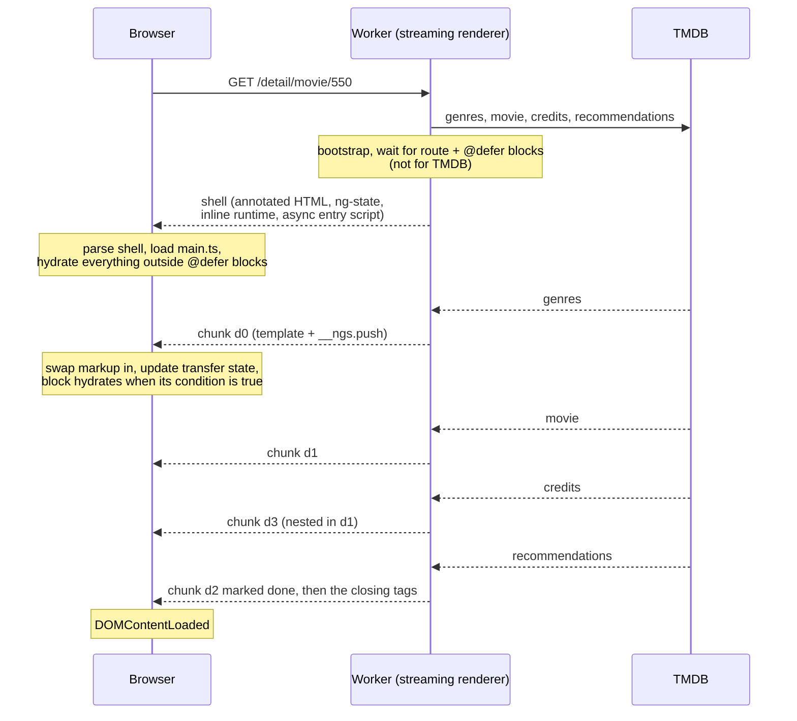

To watch these steps happen in a browser, open
[the demo](https://angular-stream-demo.chris-holder.workers.dev/): `/walkthrough`
has one labelled box per behaviour described here and a live event log, and
`/inspect` shows each flush of its response as it arrives.

## The request at a glance



One HTTP response, one body. The response stays open until the last request
the server is making has been answered and rendered. Every flush before that
leaves `<body>` open.

## Walkthrough: `/detail/movie/550`

The movie page has four `@defer` blocks with a `hydrate` trigger:

| Block | What                           | Trigger                                    | Where                              |
| ----- | ------------------------------ | ------------------------------------------ | ---------------------------------- |
| `d0`  | Genre links in the side drawer | `hydrate when genres().length > 0`         | `app-shell.component.html`         |
| `d1`  | Movie details                  | `hydrate when movie()`                     | `movie-detail-page.component.html` |
| `d3`  | Cast list, nested inside `d1`  | `hydrate when castList().value.length > 0` | same                               |
| `d2`  | Recommended movies             | `hydrate when !recommendations().loading`  | same                               |

Block ids are handed out in the order the server first meets the blocks, which
is why the nested cast block is `d3` and not `d2`. It only exists once `d1`
has rendered.

**How this was captured:** `npm run dev` on `main`, the response read in
headless Chrome, with timings taken in the page. TMDB answers in about 70 ms
locally, so everything lands within a few milliseconds of everything else. For
these captures the server's TMDB requests were delayed on purpose (genres
400 ms, movie 700 ms, credits 1300 ms, recommendations 1800 ms) to pull the
steps apart. The sizes are raw, uncompressed bytes.

|    Time | Flush              |     Size | What changes                                     | Hydrated |
| ------: | ------------------ | -------: | ------------------------------------------------ | -------: |
|   40 ms | Shell              |  32.1 KB | Everything outside the blocks, plus placeholders | 65–84 ms |
|  473 ms | Chunk `d0`         |  11.2 KB | 19 genre links                                   |   479 ms |
|  779 ms | Chunk `d1`         |   9.7 KB | Movie details, with an empty cast block inside   |   785 ms |
| 1450 ms | Chunk `d3`         | 123.2 KB | 75 cast members                                  |  1458 ms |
| 1884 ms | Chunk `d2`, `done` |  43.8 KB | 20 recommended movies                            |  1890 ms |
| 1888 ms | Tail               |     14 B | `</body></html>`, `DOMContentLoaded` fires       |          |

Without the added delay, the same page goes: shell parsed at 34 ms, Angular
attached at 57 ms, shell hydrated at 76 ms, first contentful paint at 79 ms,
last chunk at 152 ms, and everything hydrated by 157 ms.

In the mockups below, each region is labelled with its state:

- **not sent**: the document has only the block's anchor comment, nothing in front of it
- **placeholder**: server HTML for the loading state (a loader, an empty list)
- **server HTML**: real content, not yet hydrated
- **hydrated**: Angular has claimed the nodes and owns them

### 1. The shell arrives (40 ms)

```text
┌─ /detail/movie/550 ──────────────────────────────── response still open ─┐
│ ┌─ drawer · server HTML ┐ ┌─ toolbar · server HTML ────────────────────┐ │
│ │ movies logo           │ │ menu  [ search ........ ]  theme  account  │ │
│ │ Popular               │ └────────────────────────────────────────────┘ │
│ │ Top Rated             │ ┌─ d1 · placeholder ─────────────────────────┐ │
│ │ Upcoming              │ │ (spinner)  div.loader                      │ │
│ │ Genres                │ └────────────────────────────────────────────┘ │
│ │ ┌┄ d0 · not sent ┄┄┄┐ │ ┌─ header · server HTML ─────────────────────┐ │
│ │ ┊ (empty slot)      ┊ │ │ Recommended / Movies                       │ │
│ │ └┄┄┄┄┄┄┄┄┄┄┄┄┄┄┄┄┄┄┄┘ │ └────────────────────────────────────────────┘ │
│ └───────────────────────┘ ┌─ d2 · placeholder ─────────────────────────┐ │
│                           │ No results :(   (spinner)  div.loader      │ │
│                           └────────────────────────────────────────────┘ │
└──────────────────────────────────────────────────────────────────────────┘
```

The server bootstrapped the app and waited for `whenStable()` with HTTP left
out of it, then rendered the `@defer` blocks (see
[`defer-blocks.ts`](../../../../../packages/core/src/server/defer-blocks.ts)). No TMDB request
has answered yet, so every block holds its loading state.

```html
<!doctype html><html><head>
  … component <style> blocks, modulepreload links …
</head><body><!--nghm-->
<app-root ngh="4" ng-server-context="streamed-ssr">
  <ui-side-drawer> … <h3>Genres</h3><!--container--><!--ngh=d0--></nav> …
  <div class="content"><ct-movie ngh="3">
    <article class="movie-detail-wrapper">
      <div class="loader"></div><!--ngh=d1-->
    </article>
    <article class="recommendations"><h1>Recommended</h1><h2>Movies</h2>
      <ui-movie-list> No results <fast-svg name="sad"/> </ui-movie-list>
      <div class="loader"></div><!--ngh=d2-->
    </article>
</app-root>
<script id="ng-state" type="application/json">
  {"__nghData__":[ …5 views ],"__nghDeferData__":{"d0":…,"d1":…,"d2":…}}
</script>
<script>(()=>{ var S=window.__ngs=Object.assign({done:false,log:[],sink:null},
  {"n":5,"p":["GET …/genre/movie/list","GET …/movie/550?append_to_response=videos",
             "GET …/movie/550/credits","GET …/movie/550/recommendations?…"]}); … })()</script>
<script type="module" src="/src/main.ts" async></script>
```

There is no `</body></html>`; the response is still open.

- Each block is marked by an `<!--ngh=dN-->` anchor comment. Its content
  is the nodes in front of the anchor.
- `ng-state` is the transfer state as it was when the shell was taken. It
  holds hydration data for the shell, and no TMDB responses yet.
- The inline runtime installs `window.__ngs`. `n` is how many hydration
  views the shell holds, and `p` lists the requests still in flight.
- The entry script has been moved from `<head>` to here and marked `async`.
  A module script is deferred by default and would wait for the end of the
  document, which is the end of the stream. `async` lets Angular start now,
  and placing it last guarantees `<app-root>` and `ng-state` are parsed
  before it can run.

### 2. Angular boots and hydrates the shell (60 ms, done by 84 ms)

```text
┌─ /detail/movie/550 ──────────────────────────────── response still open ─┐
│ ┌─ drawer · hydrated ───┐ ┌─ toolbar · hydrated ───────────────────────┐ │
│ │ movies logo           │ │ menu  [ search ........ ]  theme  account  │ │
│ │ Popular               │ └────────────────────────────────────────────┘ │
│ │ Top Rated             │ ┌─ d1 · placeholder ─────────────────────────┐ │
│ │ Upcoming              │ │ (spinner)  div.loader                      │ │
│ │ Genres                │ └────────────────────────────────────────────┘ │
│ │ ┌┄ d0 · not sent ┄┄┄┐ │ ┌─ header · hydrated ────────────────────────┐ │
│ │ ┊ (empty slot)      ┊ │ │ Recommended / Movies                       │ │
│ │ └┄┄┄┄┄┄┄┄┄┄┄┄┄┄┄┄┄┄┄┘ │ └────────────────────────────────────────────┘ │
│ └───────────────────────┘ ┌─ d2 · placeholder ─────────────────────────┐ │
│                           │ No results :(   (spinner)  div.loader      │ │
│                           └────────────────────────────────────────────┘ │
└──────────────────────────────────────────────────────────────────────────┘
```

No new bytes. `main.ts` has loaded and runs while the response is still open:

- `provideStreamHydration()` attaches `StreamHydrationClient` to the runtime
  (`__ngs.sink`). It reads the hydration data and the list of pending requests,
  and replays any chunks that arrived before Angular did (`__ngs.log`; none
  here).
- Everything outside a block hydrates: the drawer, toolbar and headers work
  from here on.
- `d1` and `d2` stay as server HTML. Their `hydrate when` conditions are false
  because there is no data yet, and Angular leaves a dehydrated block's markup
  alone until its trigger fires. That is what lets the stream replace it
  underneath a running app.
- The movie page asks for `/movie/550` itself. `streamHttpInterceptor` sees
  that the server is already making that request and holds it back until the
  response arrives on the stream. The client never fetches what the server is
  fetching.

### 3. Chunk `d0`: genres (473 ms, hydrated at 479 ms)

```text
┌─ /detail/movie/550 ──────────────────────────────── response still open ─┐
│ ┌─ drawer · hydrated ───┐ ┌─ toolbar · hydrated ───────────────────────┐ │
│ │ movies logo           │ │ menu  [ search ........ ]  theme  account  │ │
│ │ Popular               │ └────────────────────────────────────────────┘ │
│ │ Top Rated             │ ┌─ d1 · placeholder ─────────────────────────┐ │
│ │ Upcoming              │ │ (spinner)  div.loader                      │ │
│ │ Genres                │ └────────────────────────────────────────────┘ │
│ │ ┌─ d0 · hydrated ───┐ │ ┌─ header · hydrated ────────────────────────┐ │
│ │ │ Action            │ │ │ Recommended / Movies                       │ │
│ │ │ Adventure         │ │ └────────────────────────────────────────────┘ │
│ │ │ ... 19 links      │ │ ┌─ d2 · placeholder ─────────────────────────┐ │
│ │ └───────────────────┘ │ │ No results :(   (spinner)  div.loader      │ │
│ └───────────────────────┘ └────────────────────────────────────────────┘ │
└──────────────────────────────────────────────────────────────────────────┘
```

```html
<template data-ngs="d0">
  <a class="navigation--link" data-uf="menu-gen-28" href="/list/genre/28" ngb="d0">
    <fast-svg name="genre" ngh="0"><svg>…</svg></fast-svg> Action
  </a>
  … 19 genre links …
</template>
<script>
  __ngs.push({"b":[{"id":"d0","o":1,"n":[…],"v":{…},"d":{"d0":…}}],
    "s":{"f24df949…":{ /genre/movie/list response }},
    "p":[ 3 requests still in flight ]})
</script>
```

The script runs the moment the parser reaches it. It removes the block's
current root nodes in front of `<!--ngh=d0-->`, moves the template's content
in their place, and hands the chunk to the app. The app puts the genre
response into transfer state and releases the held request. `genres()` fills,
the trigger turns true, and `d0` hydrates against the markup that has just
arrived.

### 4. Chunk `d1`: movie details (779 ms, hydrated at 785 ms)

```text
┌─ /detail/movie/550 ──────────────────────────────── response still open ─┐
│ ┌─ drawer · hydrated ───┐ ┌─ toolbar · hydrated ───────────────────────┐ │
│ │ movies logo           │ │ menu  [ search ........ ]  theme  account  │ │
│ │ Popular               │ └────────────────────────────────────────────┘ │
│ │ Top Rated             │ ┌─ d1 · hydrated ────────────────────────────┐ │
│ │ Upcoming              │ │ +------+  Fight Club                       │ │
│ │ Genres                │ │ |poster|  rating, runtime, release         │ │
│ │ ┌─ d0 · hydrated ───┐ │ │ +------+  genres, synopsis, buttons        │ │
│ │ │ Action            │ │ │ ┌─ d3 cast · placeholder ────────────────┐ │ │
│ │ │ Adventure         │ │ │ │ (spinner)  div.loader                  │ │ │
│ │ │ ... 19 links      │ │ │ └────────────────────────────────────────┘ │ │
│ │ └───────────────────┘ │ └────────────────────────────────────────────┘ │
│ └───────────────────────┘ ┌─ header · hydrated ────────────────────────┐ │
│                           │ Recommended / Movies                       │ │
│                           └────────────────────────────────────────────┘ │
│                           ┌─ d2 · placeholder ─────────────────────────┐ │
│                           │ No results :(   (spinner)  div.loader      │ │
│                           └────────────────────────────────────────────┘ │
└──────────────────────────────────────────────────────────────────────────┘
```

```html
<template data-ngs="d1">
  <ui-detail-grid style="opacity: 1;" ngh="0">
    
    <h1 data-uf="header-main">Fight Club</h1>
    …
    <div class="cast-list">
      <div class="loader"></div>
      <!--ngh=d3-->
    </div>
    …
  </ui-detail-grid>
</template>
<script>
  __ngs.push({"b":[{"id":"d1","o":3,"n":[…2 views],"v":{…},
    "d":{"d1":{"r":3,"s":2},"d3":{"r":3,"s":2,"p":"d1"}}}],
    "s":{"6f68cf69…":{ /movie/550 response }},"p":[ credits, recommendations ]})
</script>
```

The block brings a new block with it: `d3`, the cast list, still showing its
loader. Its defer info (`"p":"d1"`) names `d1` as its parent.

### 5. Chunk `d3`: cast, inside a block that has already hydrated (1450 ms, hydrated at 1458 ms)

```text
┌─ /detail/movie/550 ──────────────────────────────── response still open ─┐
│ ┌─ drawer · hydrated ───┐ ┌─ toolbar · hydrated ───────────────────────┐ │
│ │ movies logo           │ │ menu  [ search ........ ]  theme  account  │ │
│ │ Popular               │ └────────────────────────────────────────────┘ │
│ │ Top Rated             │ ┌─ d1 · hydrated ────────────────────────────┐ │
│ │ Upcoming              │ │ +------+  Fight Club                       │ │
│ │ Genres                │ │ |poster|  rating, runtime, release         │ │
│ │ ┌─ d0 · hydrated ───┐ │ │ +------+  genres, synopsis, buttons        │ │
│ │ │ Action            │ │ │ ┌─ d3 cast · hydrated ───────────────────┐ │ │
│ │ │ Adventure         │ │ │ │ Edward Norton, Brad Pitt ... 75 cast   │ │ │
│ │ │ ... 19 links      │ │ │ └────────────────────────────────────────┘ │ │
│ │ └───────────────────┘ │ └────────────────────────────────────────────┘ │
│ └───────────────────────┘ ┌─ header · hydrated ────────────────────────┐ │
│                           │ Recommended / Movies                       │ │
│                           └────────────────────────────────────────────┘ │
│                           ┌─ d2 · placeholder ─────────────────────────┐ │
│                           │ No results :(   (spinner)  div.loader      │ │
│                           └────────────────────────────────────────────┘ │
└──────────────────────────────────────────────────────────────────────────┘
```

```html
<template data-ngs="d3">
  <a
    class="movie-detail--cast-actor"
    data-uf="cast-0"
    aria-label="Edward Norton"
    href="/detail/person/819"
    ngb="d3"
    ><picture></picture
  ></a>
  … 75 cast members …
</template>
<script>
  __ngs.push({"b":[{"id":"d3","o":3,"n":[],"v":{…},"d":{"d3":…}}],
    "s":{"78edcd5a…":{ /movie/550/credits response }},"p":[ recommendations ]})
</script>
```

`d1` belongs to Angular by now, but `d3` inside it is still dehydrated, so it
can still be replaced on its own. The server sends only `d3`: a nested block
that changed does not make the block around it count as changed.

Of this chunk's 123 KB, 40.6 KB is markup. The rest is the transfer state for
`/credits`, the whole response, crew included.

### 6. Chunk `d2` and the end of the document (1884 ms, hydrated at 1890 ms)

```text
┌─ /detail/movie/550 ──────────────────────────────────── response closed ─┐
│ ┌─ drawer · hydrated ───┐ ┌─ toolbar · hydrated ───────────────────────┐ │
│ │ movies logo           │ │ menu  [ search ........ ]  theme  account  │ │
│ │ Popular               │ └────────────────────────────────────────────┘ │
│ │ Top Rated             │ ┌─ d1 · hydrated ────────────────────────────┐ │
│ │ Upcoming              │ │ +------+  Fight Club                       │ │
│ │ Genres                │ │ |poster|  rating, runtime, release         │ │
│ │ ┌─ d0 · hydrated ───┐ │ │ +------+  genres, synopsis, buttons        │ │
│ │ │ Action            │ │ │ ┌─ d3 cast · hydrated ───────────────────┐ │ │
│ │ │ Adventure         │ │ │ │ Edward Norton, Brad Pitt ... 75 cast   │ │ │
│ │ │ ... 19 links      │ │ │ └────────────────────────────────────────┘ │ │
│ │ └───────────────────┘ │ └────────────────────────────────────────────┘ │
│ └───────────────────────┘ ┌─ header · hydrated ────────────────────────┐ │
│                           │ Recommended / Movies                       │ │
│                           └────────────────────────────────────────────┘ │
│                           ┌─ d2 · hydrated ────────────────────────────┐ │
│                           │ Sin City, ... 20 posters                   │ │
│                           └────────────────────────────────────────────┘ │
└──────────────────────────────────────────────────────────────────────────┘
```

```html
<template data-ngs="d2">
  <ui-movie-list ngh="0"><ui-grid-list ngh="1">
    <a class="ui-grid-list-item" data-uf="movie-0" href="/detail/movie/187" ngb="d2">
       …
    … 20 movies …
</template>
<script>__ngs.push({"b":[{"id":"d2","o":3,…}],
  "s":{"11dff7ad…":{ /recommendations response }},"p":[],"done":true})</script>
</body></html>
```

`"done": true` says nothing else is coming. The client hands Angular every
block it was holding back (see below), and the parser finishes:
`DOMContentLoaded` fires. The page ends with 1,079 hydrated nodes and no
hydration errors.
