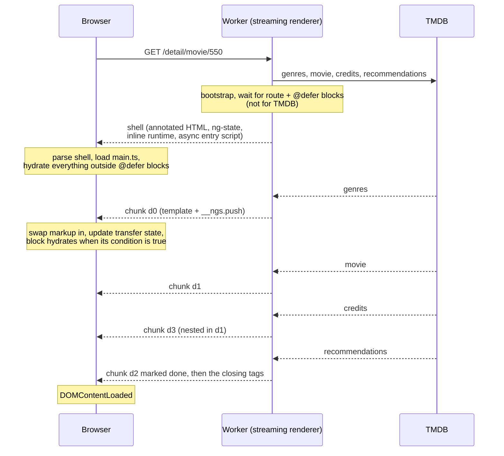

# Streamed hydration

How a page request is answered in pieces, and how the browser hydrates each
piece while the rest is still on its way. The [README](../README.md#streamed-hydration)
has the short version and the rules for templates; this is the long one, with
a real response taken apart flush by flush.

To watch these steps happen in a browser, open
[the demo](https://angular-stream-demo.chris-holder.workers.dev/), or run it
locally with `npm run dev:demo`:

- `/` is the place to start. It explains why, with the same page sent three
  ways on one clock, and how, with one response stepped through piece by piece.
- `/example` does it for real with one widget (the shell, the widget streamed in
  five seconds later, then its hydration) and shows the least code that does it.
- `/walkthrough` has one labelled box per behaviour described here and a live
  event log.
- `/inspect` shows each flush of the walkthrough's response as it arrives.

Contents:

- [Why stream out of order](#why-stream-out-of-order)
- [The request at a glance](#the-request-at-a-glance)
- [Walkthrough: `/detail/movie/550`](#walkthrough-detailmovie550)
- [The wire format](#the-wire-format)
- [What the server does on each flush](#what-the-server-does-on-each-flush)
- [What the browser does with a chunk](#what-the-browser-does-with-a-chunk)
- [Consequences for templates](#consequences-for-templates)
- [When something goes wrong](#when-something-goes-wrong)
- [Verifying a change](#verifying-a-change)

## Why stream out of order

Angular renders a page on the server and sends it whole, so a page is as slow
as its slowest request: if the product renders at once, the reviews take one
second and the recommendations three, the reader gets a blank page for three
seconds. There are two ways to stream instead:

- **In order.** HTML goes out top to bottom as it is ready. The top of the page
  arrives early, but a slow part still holds back everything below it.
- **Out of order.** Everything that is ready goes out at once, with a
  placeholder for each part that is not. Each part follows when its data
  arrives, in whatever order that is, and a script puts it in place.

All of them finish at the same moment; streaming does not make a slow request
faster. What changes is that the rest of the page, and the browser's work on
styles, fonts and scripts, no longer waits for it.

The idea is about fifteen years old, and each framework that has it gives the
same reason:

| When | Who                    | How a late part is placed                                    | In their words                                                                                             |
| ---- | ---------------------- | ------------------------------------------------------------ | ---------------------------------------------------------------------------------------------------------- |
| 2010 | Facebook, [BigPipe][1] | A script call sets the placeholder's `innerHTML`             | "When the web server is busy generating a page, the browser is idle and wasting its cycles doing nothing." |
| 2014 | eBay, [Marko][2]       | Fragment in a hidden element, a script moves it to its id    | Without it, "the user will be staring at a blank screen for a large portion of the time."                  |
| 2021 | [React 18][3]          | Fallback first, then HTML and an inline script that swaps it | "Unlike traditional HTML streaming, it doesn't have to happen in the top-down order."                      |
|      | [Next.js][4]           | React's, per `<Suspense>` boundary or `loading.js`           | "A single slow database query or API call can block the entire page."                                      |
|      | [SvelteKit][5]         | Promises returned from a server `load` are streamed          | "This is useful if you have slow, non-essential data"                                                      |
|      | [Qwik][6]              | Experimental, inside `<Pending>`                             | "Out-of-order streaming helps when one section of the page is slow, but the rest of the page is ready."    |
| 2026 | [The browser][7]       | `<template for>` fills a `<?marker>`, with no script         | "primitives that have been part of userland libraries for about a decade"                                  |

The native version is new: Chrome's intent to ship targets version 150, and
[Chrome's guide][8] describes it as "shipped in only a single browser engine".
This project places late parts with a small inline script, as the libraries do.

Angular itself has no streaming, and its [roadmap][9] lists none. What it has is
[incremental hydration][10]: a `@defer` block with a `hydrate` trigger stays as
plain server HTML until the trigger fires. Angular is not touching that markup
yet, which is what lets the server replace it underneath a running application,
and it is the piece everything below builds on.

The costs are the same everywhere, and apply here:

- **The status code goes out with the shell.** A part that fails later cannot
  turn the response into an error page or a redirect.
- **Placeholders get replaced,** so content can shift unless each placeholder
  holds the room its content will need.
- **A late part needs JavaScript** to be put in place.
- **Streamed responses are not cached** as they stand; see
  [When something goes wrong](#when-something-goes-wrong).

[1]: https://engineering.fb.com/2010/06/04/web/bigpipe-pipelining-web-pages-for-high-performance/
[2]: https://calendar.perfplanet.com/2014/async-fragments-rediscovering-progressive-html-rendering-with-marko/
[3]: https://github.com/reactwg/react-18/discussions/37
[4]: https://nextjs.org/docs/app/guides/streaming
[5]: https://svelte.dev/docs/kit/load
[6]: https://next.qwik.dev/docs/labs/suspense/
[7]: https://groups.google.com/a/chromium.org/g/blink-dev/c/eAUPFR-sloc
[8]: https://developer.chrome.com/docs/modern-web-guidance/guides/performance/out-of-order-html-streaming
[9]: https://angular.dev/roadmap
[10]: https://angular.dev/guide/incremental-hydration

## The request at a glance



One HTTP response, one body. The response stays open until the last request
the server is making has been answered and rendered. Every flush before that
leaves `<body>` open.

## Walkthrough: `/detail/movie/550`

The movie page has four `@defer` blocks with a `hydrate` trigger:

| Block | What                           | Trigger                                    | Where                              |
| ----- | ------------------------------ | ------------------------------------------ | ---------------------------------- |
| `d0`  | Genre links in the side drawer | `hydrate when genres().length > 0`         | `app-shell.component.html`         |
| `d1`  | Movie details                  | `hydrate when movie()`                     | `movie-detail-page.component.html` |
| `d3`  | Cast list, nested inside `d1`  | `hydrate when castList().value.length > 0` | same                               |
| `d2`  | Recommended movies             | `hydrate when !recommendations().loading`  | same                               |

Block ids are handed out in the order the server first meets the blocks, which
is why the nested cast block is `d3` and not `d2`. It only exists once `d1`
has rendered.

**How this was captured:** `npm run dev` on `main`, the response read in
headless Chrome, with timings taken in the page. TMDB answers in about 70 ms
locally, so everything lands within a few milliseconds of everything else. For
these captures the server's TMDB requests were delayed on purpose (genres
400 ms, movie 700 ms, credits 1300 ms, recommendations 1800 ms) to pull the
steps apart. The sizes are raw, uncompressed bytes.

|    Time | Flush              |     Size | What changes                                     | Hydrated |
| ------: | ------------------ | -------: | ------------------------------------------------ | -------: |
|   40 ms | Shell              |  32.1 KB | Everything outside the blocks, plus placeholders | 65–84 ms |
|  473 ms | Chunk `d0`         |  11.2 KB | 19 genre links                                   |   479 ms |
|  779 ms | Chunk `d1`         |   9.7 KB | Movie details, with an empty cast block inside   |   785 ms |
| 1450 ms | Chunk `d3`         | 123.2 KB | 75 cast members                                  |  1458 ms |
| 1884 ms | Chunk `d2`, `done` |  43.8 KB | 20 recommended movies                            |  1890 ms |
| 1888 ms | Tail               |     14 B | `</body></html>`, `DOMContentLoaded` fires       |          |

Without the added delay, the same page goes: shell parsed at 34 ms, Angular
attached at 57 ms, shell hydrated at 76 ms, first contentful paint at 79 ms,
last chunk at 152 ms, and everything hydrated by 157 ms.

In the mockups below, each region is labelled with its state:

- **not sent**: the document has only the block's anchor comment, nothing in front of it
- **placeholder**: server HTML for the loading state (a loader, an empty list)
- **server HTML**: real content, not yet hydrated
- **hydrated**: Angular has claimed the nodes and owns them

### 1. The shell arrives (40 ms)

```text
┌─ /detail/movie/550 ──────────────────────────────── response still open ─┐
│ ┌─ drawer · server HTML ┐ ┌─ toolbar · server HTML ────────────────────┐ │
│ │ movies logo           │ │ menu  [ search ........ ]  theme  account  │ │
│ │ Popular               │ └────────────────────────────────────────────┘ │
│ │ Top Rated             │ ┌─ d1 · placeholder ─────────────────────────┐ │
│ │ Upcoming              │ │ (spinner)  div.loader                      │ │
│ │ Genres                │ └────────────────────────────────────────────┘ │
│ │ ┌┄ d0 · not sent ┄┄┄┐ │ ┌─ header · server HTML ─────────────────────┐ │
│ │ ┊ (empty slot)      ┊ │ │ Recommended / Movies                       │ │
│ │ └┄┄┄┄┄┄┄┄┄┄┄┄┄┄┄┄┄┄┄┘ │ └────────────────────────────────────────────┘ │
│ └───────────────────────┘ ┌─ d2 · placeholder ─────────────────────────┐ │
│                           │ No results :(   (spinner)  div.loader      │ │
│                           └────────────────────────────────────────────┘ │
└──────────────────────────────────────────────────────────────────────────┘
```

The server bootstrapped the app and waited for `whenStable()` with HTTP left
out of it, then rendered the `@defer` blocks (see
[`defer-blocks.ts`](../packages/streaming/src/server/defer-blocks.ts)). No TMDB request
has answered yet, so every block holds its loading state.

```html
<!doctype html><html><head>
  … component <style> blocks, modulepreload links …
</head><body><!--nghm-->
<app-root ngh="4" ng-server-context="streamed-ssr">
  <ui-side-drawer> … <h3>Genres</h3><!--container--><!--ngh=d0--></nav> …
  <div class="content"><ct-movie ngh="3">
    <article class="movie-detail-wrapper">
      <div class="loader"></div><!--ngh=d1-->
    </article>
    <article class="recommendations"><h1>Recommended</h1><h2>Movies</h2>
      <ui-movie-list> No results <fast-svg name="sad"/> </ui-movie-list>
      <div class="loader"></div><!--ngh=d2-->
    </article>
</app-root>
<script id="ng-state" type="application/json">
  {"__nghData__":[ …5 views ],"__nghDeferData__":{"d0":…,"d1":…,"d2":…}}
</script>
<script>(()=>{ var S=window.__ngs=Object.assign({done:false,log:[],sink:null},
  {"n":5,"p":["GET …/genre/movie/list","GET …/movie/550?append_to_response=videos",
             "GET …/movie/550/credits","GET …/movie/550/recommendations?…"]}); … })()</script>
<script type="module" src="/src/main.ts" async></script>
```

There is no `</body></html>`; the response is still open.

- Each block is marked by an `<!--ngh=dN-->` anchor comment. Its content
  is the nodes in front of the anchor.
- `ng-state` is the transfer state as it was when the shell was taken. It
  holds hydration data for the shell, and no TMDB responses yet.
- The inline runtime installs `window.__ngs`. `n` is how many hydration
  views the shell holds, and `p` lists the requests still in flight.
- The entry script has been moved from `<head>` to here and marked `async`.
  A module script is deferred by default and would wait for the end of the
  document, which is the end of the stream. `async` lets Angular start now,
  and placing it last guarantees `<app-root>` and `ng-state` are parsed
  before it can run.

### 2. Angular boots and hydrates the shell (60 ms, done by 84 ms)

```text
┌─ /detail/movie/550 ──────────────────────────────── response still open ─┐
│ ┌─ drawer · hydrated ───┐ ┌─ toolbar · hydrated ───────────────────────┐ │
│ │ movies logo           │ │ menu  [ search ........ ]  theme  account  │ │
│ │ Popular               │ └────────────────────────────────────────────┘ │
│ │ Top Rated             │ ┌─ d1 · placeholder ─────────────────────────┐ │
│ │ Upcoming              │ │ (spinner)  div.loader                      │ │
│ │ Genres                │ └────────────────────────────────────────────┘ │
│ │ ┌┄ d0 · not sent ┄┄┄┐ │ ┌─ header · hydrated ────────────────────────┐ │
│ │ ┊ (empty slot)      ┊ │ │ Recommended / Movies                       │ │
│ │ └┄┄┄┄┄┄┄┄┄┄┄┄┄┄┄┄┄┄┄┘ │ └────────────────────────────────────────────┘ │
│ └───────────────────────┘ ┌─ d2 · placeholder ─────────────────────────┐ │
│                           │ No results :(   (spinner)  div.loader      │ │
│                           └────────────────────────────────────────────┘ │
└──────────────────────────────────────────────────────────────────────────┘
```

No new bytes. `main.ts` has loaded and runs while the response is still open:

- `provideStreamHydration()` attaches `StreamHydrationClient` to the runtime
  (`__ngs.sink`). It reads the hydration data and the list of pending requests,
  and replays any chunks that arrived before Angular did (`__ngs.log`; none
  here).
- Everything outside a block hydrates: the drawer, toolbar and headers work
  from here on.
- `d1` and `d2` stay as server HTML. Their `hydrate when` conditions are false
  because there is no data yet, and Angular leaves a dehydrated block's markup
  alone until its trigger fires. That is what lets the stream replace it
  underneath a running app.
- The movie page asks for `/movie/550` itself. `streamHttpInterceptor` sees
  that the server is already making that request and holds it back until the
  response arrives on the stream. The client never fetches what the server is
  fetching.

### 3. Chunk `d0`: genres (473 ms, hydrated at 479 ms)

```text
┌─ /detail/movie/550 ──────────────────────────────── response still open ─┐
│ ┌─ drawer · hydrated ───┐ ┌─ toolbar · hydrated ───────────────────────┐ │
│ │ movies logo           │ │ menu  [ search ........ ]  theme  account  │ │
│ │ Popular               │ └────────────────────────────────────────────┘ │
│ │ Top Rated             │ ┌─ d1 · placeholder ─────────────────────────┐ │
│ │ Upcoming              │ │ (spinner)  div.loader                      │ │
│ │ Genres                │ └────────────────────────────────────────────┘ │
│ │ ┌─ d0 · hydrated ───┐ │ ┌─ header · hydrated ────────────────────────┐ │
│ │ │ Action            │ │ │ Recommended / Movies                       │ │
│ │ │ Adventure         │ │ └────────────────────────────────────────────┘ │
│ │ │ ... 19 links      │ │ ┌─ d2 · placeholder ─────────────────────────┐ │
│ │ └───────────────────┘ │ │ No results :(   (spinner)  div.loader      │ │
│ └───────────────────────┘ └────────────────────────────────────────────┘ │
└──────────────────────────────────────────────────────────────────────────┘
```

```html
<template data-ngs="d0">
  <a class="navigation--link" data-uf="menu-gen-28" href="/list/genre/28" ngb="d0">
    <fast-svg name="genre" ngh="0"><svg>…</svg></fast-svg> Action
  </a>
  … 19 genre links …
</template>
<script>
  __ngs.push({"b":[{"id":"d0","o":1,"n":[…],"v":{…},"d":{"d0":…}}],
    "s":{"f24df949…":{ /genre/movie/list response }},
    "p":[ 3 requests still in flight ]})
</script>
```

The script runs the moment the parser reaches it. It removes the block's
current root nodes in front of `<!--ngh=d0-->`, moves the template's content
in their place, and hands the chunk to the app. The app puts the genre
response into transfer state and releases the held request. `genres()` fills,
the trigger turns true, and `d0` hydrates against the markup that has just
arrived.

### 4. Chunk `d1`: movie details (779 ms, hydrated at 785 ms)

```text
┌─ /detail/movie/550 ──────────────────────────────── response still open ─┐
│ ┌─ drawer · hydrated ───┐ ┌─ toolbar · hydrated ───────────────────────┐ │
│ │ movies logo           │ │ menu  [ search ........ ]  theme  account  │ │
│ │ Popular               │ └────────────────────────────────────────────┘ │
│ │ Top Rated             │ ┌─ d1 · hydrated ────────────────────────────┐ │
│ │ Upcoming              │ │ +------+  Fight Club                       │ │
│ │ Genres                │ │ |poster|  rating, runtime, release         │ │
│ │ ┌─ d0 · hydrated ───┐ │ │ +------+  genres, synopsis, buttons        │ │
│ │ │ Action            │ │ │ ┌─ d3 cast · placeholder ────────────────┐ │ │
│ │ │ Adventure         │ │ │ │ (spinner)  div.loader                  │ │ │
│ │ │ ... 19 links      │ │ │ └────────────────────────────────────────┘ │ │
│ │ └───────────────────┘ │ └────────────────────────────────────────────┘ │
│ └───────────────────────┘ ┌─ header · hydrated ────────────────────────┐ │
│                           │ Recommended / Movies                       │ │
│                           └────────────────────────────────────────────┘ │
│                           ┌─ d2 · placeholder ─────────────────────────┐ │
│                           │ No results :(   (spinner)  div.loader      │ │
│                           └────────────────────────────────────────────┘ │
└──────────────────────────────────────────────────────────────────────────┘
```

```html
<template data-ngs="d1">
  <ui-detail-grid style="opacity: 1;" ngh="0">
    
    <h1 data-uf="header-main">Fight Club</h1>
    …
    <div class="cast-list">
      <div class="loader"></div>
      <!--ngh=d3-->
    </div>
    …
  </ui-detail-grid>
</template>
<script>
  __ngs.push({"b":[{"id":"d1","o":3,"n":[…2 views],"v":{…},
    "d":{"d1":{"r":3,"s":2},"d3":{"r":3,"s":2,"p":"d1"}}}],
    "s":{"6f68cf69…":{ /movie/550 response }},"p":[ credits, recommendations ]})
</script>
```

The block brings a new block with it: `d3`, the cast list, still showing its
loader. Its defer info (`"p":"d1"`) names `d1` as its parent.

### 5. Chunk `d3`: cast, inside a block that has already hydrated (1450 ms, hydrated at 1458 ms)

```text
┌─ /detail/movie/550 ──────────────────────────────── response still open ─┐
│ ┌─ drawer · hydrated ───┐ ┌─ toolbar · hydrated ───────────────────────┐ │
│ │ movies logo           │ │ menu  [ search ........ ]  theme  account  │ │
│ │ Popular               │ └────────────────────────────────────────────┘ │
│ │ Top Rated             │ ┌─ d1 · hydrated ────────────────────────────┐ │
│ │ Upcoming              │ │ +------+  Fight Club                       │ │
│ │ Genres                │ │ |poster|  rating, runtime, release         │ │
│ │ ┌─ d0 · hydrated ───┐ │ │ +------+  genres, synopsis, buttons        │ │
│ │ │ Action            │ │ │ ┌─ d3 cast · hydrated ───────────────────┐ │ │
│ │ │ Adventure         │ │ │ │ Edward Norton, Brad Pitt ... 75 cast   │ │ │
│ │ │ ... 19 links      │ │ │ └────────────────────────────────────────┘ │ │
│ │ └───────────────────┘ │ └────────────────────────────────────────────┘ │
│ └───────────────────────┘ ┌─ header · hydrated ────────────────────────┐ │
│                           │ Recommended / Movies                       │ │
│                           └────────────────────────────────────────────┘ │
│                           ┌─ d2 · placeholder ─────────────────────────┐ │
│                           │ No results :(   (spinner)  div.loader      │ │
│                           └────────────────────────────────────────────┘ │
└──────────────────────────────────────────────────────────────────────────┘
```

```html
<template data-ngs="d3">
  <a
    class="movie-detail--cast-actor"
    data-uf="cast-0"
    aria-label="Edward Norton"
    href="/detail/person/819"
    ngb="d3"
    ><picture></picture
  ></a>
  … 75 cast members …
</template>
<script>
  __ngs.push({"b":[{"id":"d3","o":3,"n":[],"v":{…},"d":{"d3":…}}],
    "s":{"78edcd5a…":{ /movie/550/credits response }},"p":[ recommendations ]})
</script>
```

`d1` belongs to Angular by now, but `d3` inside it is still dehydrated, so it
can still be replaced on its own. The server sends only `d3`: a nested block
that changed does not make the block around it count as changed.

Of this chunk's 123 KB, 40.6 KB is markup. The rest is the transfer state for
`/credits`, the whole response, crew included.

### 6. Chunk `d2` and the end of the document (1884 ms, hydrated at 1890 ms)

```text
┌─ /detail/movie/550 ──────────────────────────────────── response closed ─┐
│ ┌─ drawer · hydrated ───┐ ┌─ toolbar · hydrated ───────────────────────┐ │
│ │ movies logo           │ │ menu  [ search ........ ]  theme  account  │ │
│ │ Popular               │ └────────────────────────────────────────────┘ │
│ │ Top Rated             │ ┌─ d1 · hydrated ────────────────────────────┐ │
│ │ Upcoming              │ │ +------+  Fight Club                       │ │
│ │ Genres                │ │ |poster|  rating, runtime, release         │ │
│ │ ┌─ d0 · hydrated ───┐ │ │ +------+  genres, synopsis, buttons        │ │
│ │ │ Action            │ │ │ ┌─ d3 cast · hydrated ───────────────────┐ │ │
│ │ │ Adventure         │ │ │ │ Edward Norton, Brad Pitt ... 75 cast   │ │ │
│ │ │ ... 19 links      │ │ │ └────────────────────────────────────────┘ │ │
│ │ └───────────────────┘ │ └────────────────────────────────────────────┘ │
│ └───────────────────────┘ ┌─ header · hydrated ────────────────────────┐ │
│                           │ Recommended / Movies                       │ │
│                           └────────────────────────────────────────────┘ │
│                           ┌─ d2 · hydrated ────────────────────────────┐ │
│                           │ Sin City, ... 20 posters                   │ │
│                           └────────────────────────────────────────────┘ │
└──────────────────────────────────────────────────────────────────────────┘
```

```html
<template data-ngs="d2">
  <ui-movie-list ngh="0"><ui-grid-list ngh="1">
    <a class="ui-grid-list-item" data-uf="movie-0" href="/detail/movie/187" ngb="d2">
       …
    … 20 movies …
</template>
<script>__ngs.push({"b":[{"id":"d2","o":3,…}],
  "s":{"11dff7ad…":{ /recommendations response }},"p":[],"done":true})</script>
</body></html>
```

`"done": true` says nothing else is coming. The client hands Angular every
block it was holding back (see below), and the parser finishes:
`DOMContentLoaded` fires. The page ends with 1,079 hydrated nodes and no
hydration errors.

## The wire format

Defined in [`stream-protocol.ts`](../packages/streaming/src/client/stream-protocol.ts).
Field names are short because every chunk repeats them.

A chunk is the stylesheets of any components new to the page, then one
`<template data-ngs="id">` per block, then one script:

```html
<style ng-app-id="ng">
  …
</style>
<template data-ngs="d1">…the block's new root nodes…</template>
<script>
  __ngs.push({ "b": [...], "s": {...}, "p": [...], "done": true })
</script>
```

Angular adds a component's stylesheet to `<head>` the first time the component
renders: a `<style>` in a production build, a `<link>` in dev. A component that
first renders inside a streamed block does so after the shell has gone out, so
the chunk carries its stylesheet, ahead of the markup that needs it. Without
that, the block would stay unstyled until the browser rendered the component
itself at hydration.

The script comes last so every template ahead of it has been fully parsed when
it runs.

| Field     | Meaning                                                                                                                                                              |
| --------- | -------------------------------------------------------------------------------------------------------------------------------------------------------------------- |
| `b`       | Blocks to replace, in the order their templates appear                                                                                                               |
| `b[].id`  | The block's id as the client knows it, which is its `<!--ngh=id-->` anchor                                                                                           |
| `b[].o`   | How many root nodes the server thinks are in front of the anchor. Only used before Angular attaches; after that the app counts.                                      |
| `b[].v`   | The block's serialized view, replacing what the client holds                                                                                                         |
| `b[].n`   | Hydration views for components inside the block. The markup's `ngh` attributes index into this list, and the runtime rebases them onto the end of the client's list. |
| `b[].d`   | Defer info for this block and every block nested in it                                                                                                               |
| `s`       | Transfer state entries added since the previous flush (TMDB responses)                                                                                               |
| `p`       | Requests still in flight on the server, as `METHOD url`                                                                                                              |
| `done`    | The server render is complete; nothing follows                                                                                                                       |
| `aborted` | Never sent. The runtime adds it when the document ends without a `done` chunk.                                                                                       |

The shell carries `StreamInit` (`n`, `p`) inline in the runtime script.

## What the server does on each flush

[`streaming-angular-renderer.ts`](../packages/streaming/src/server/streaming-angular-renderer.ts)
loops: wait for the next tracked request to finish, wait for the app to
settle (stable, a task, stable again, so near-simultaneous responses share a
flush), render any new `@defer` blocks, then flush.

[`hydration-stream.ts`](../packages/streaming/src/server/hydration-stream.ts) builds
the flush. Angular's hydration annotation only works on a whole app, so every
flush:

1. Runs `ɵannotateForHydration` over the whole app again.
2. Finds each block and compares a signature of its own content (markup and
   view, with nested blocks cut out) against what the client was last sent.
3. Cuts out only the blocks that changed, and rewrites the two things a fresh
   pass renumbers:
   - **`ngh` indices**, which become positions in the block's own `n` list;
   - **block ids**, since a pass numbers blocks from `d0` in the order it
     meets them. Each block keeps the id the client first saw it under.
4. Adds only the transfer state keys the client does not have yet.

A flush is skipped when nothing changed: no block, no new state, the same
pending list, and not done.

## What the browser does with a chunk

**The inline runtime**
([`stream-runtime.ts`](../packages/streaming/src/server/stream-runtime.ts)) is a
classic script, so it exists before Angular does, and each chunk's script
calls it while the parser is still running. For each block it:

- takes the template, and finds the anchor comment;
- rebases the `ngh` indices in the new markup onto the end of the client's
  hydration list;
- resolves Angular's text markers (`ngetn`, `ngtns`) itself, since Angular
  only resolves them once at bootstrap;
- removes the old root nodes in front of the anchor and inserts the new ones.

Before Angular attaches, chunks are queued in `__ngs.log`. After that they go
straight to the app.

**`StreamHydrationClient`**
([`stream-hydration.ts`](../packages/streaming/src/client/stream-hydration.ts)) keeps
Angular in step:

- **Hydration data.** It rewrites the view Angular holds for a replaced block
  in place, so hydrating it later walks the new markup.
- **Declining a swap.** It reports `null` root nodes for a block Angular has
  already hydrated, and the runtime then drops that block's template.
- **HTTP.** `streamHttpInterceptor` holds back any request listed in `p` until
  a chunk no longer lists it. By then its response is in transfer state, and
  Angular's transfer cache answers it without a fetch.
- **Triggers that ignore data.** Blocks whose hydrate trigger is `idle`,
  `immediate`, `timer` or `viewport` are kept out of Angular's dehydrated block
  registry until the stream is done. Such a trigger can fire while the block's
  content is still on its way. Kept out, the block waits the way a nested block
  waits for its parent, and resumes when it is released. `hydrate when` blocks
  are never held: their condition only turns true from data that arrived in
  the same chunk as their markup.

## Consequences for templates

The rules are in the [README](../README.md#making-something-stream). A few
consequences that are easy to miss:

- **The shell is sent once.** Anything outside a `@defer` block that changes
  after the shell is taken is rendered by the client, and never appears in the
  server HTML. The list page's `<h1>`/`<h2>` are an example: they sit outside
  the block and depend on data, so the response always ships them empty, like
  `<h1 data-uf="header-main"><!--ngetn--></h1>`. If text matters to crawlers or
  to first paint, it belongs inside a block, or must not depend on data that
  arrives later.
- **The placeholder is what paints first.** Whatever a block renders with no
  data is in the shell and in the first paint. The movie lists currently render
  their empty state ("No results" and a sad icon) above the loader until their
  chunk arrives.
- **Order follows the network.** Chunks go out in the order requests finish,
  not in document order. A request that finishes before the shell is taken
  lands in the shell, and no chunk is sent for it: on a cold request the genre
  links were already in a 43 KB shell, and on warm requests they streamed as
  `d0`. Do not write tests that expect a fixed sequence of chunks.
- **Everything in transfer state ships.** A chunk carries the full response of
  each request that finished, whether the page uses all of it or not.

## When something goes wrong

- **Before the first flush:** the Worker catches the error, logs
  `[ssr] streaming render failed before commit, falling back`, and renders the
  page with a buffered `renderApplication` instead (`createStreamingWorker()`
  in [`worker.ts`](../packages/streaming/src/server/worker.ts)). That render has
  incremental hydration switched off, so `@defer` blocks are left for the
  client. A page with no `window.__ngs` came from this path.
- **After the first flush:** the status is already sent. The server logs
  `[ssr] streaming render failed after commit` and breaks the stream. The
  browser keeps what it has. When the document ends without a `done` chunk, the
  runtime pushes `{done: true, aborted: true}`, the client releases everything
  it was holding, and the app fetches what is missing itself.
- **The client goes away:** cancelling the body tears down the server
  platform.

Streamed responses are sent with `Cache-Control: no-store`: a cached copy of a
partial response would be worse than none.

## Verifying a change

`curl` shows only the server half. To check hydration you need a browser:

1. **Use `npm run dev`, not a production build.** Angular only checks that
   hydrated nodes match in dev mode. There, a claimed node has
   `node.__ngDebugHydrationInfo__.status === 'hydrated'`, and
   `ngDevMode.hydratedNodes` gives a running total. No console errors in a
   production build proves very little.
2. **Request every page at least twice on the same server process.** Angular's
   server-side `hydrate when` only throws NG0600 once a block's dependencies are
   cached in the isolate, which is from the second request on. A single request
   after a restart or an HMR update passes when it should not.
3. **Check that `window.__ngs` exists.** If it does not, the Worker fell back to
   the buffered render; look for the `[ssr]` log line.
4. **Separate the steps to see the ordering.** TMDB answers in about 70 ms
   locally, so every chunk usually lands before anything interesting can
   happen. To see a block hydrate after its chunk arrives, add a temporary
   `delay()` in the server branch of `streamHttpInterceptor`, a different one
   per URL. Remove it afterwards.
5. **Do not run `npm run dev` and `npm run preview` at the same time.** Both
   start workerd's inspector on port 9232, and the second one fails silently.

To log when chunks land relative to Angular, wrap `__ngs.push` and watch for
`__ngs.sink` being set, before any page script runs (for example with
`Page.addScriptToEvaluateOnNewDocument` over the Chrome DevTools Protocol).
